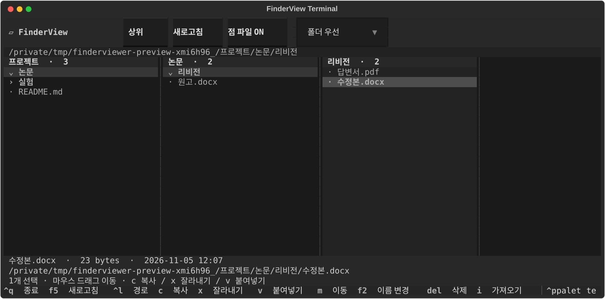

# FinderViewer Terminal

**터미널에서 Finder처럼 폴더를 열 단위로 탐색하는 파일 탐색기입니다.**

마우스로 폴더를 클릭하면 오른쪽 열에 하위 항목이 펼쳐집니다. 파일 복사·이동·이름 변경·휴지통 삭제까지 터미널 안에서 처리할 수 있습니다. Python과 Textual로 만들었으며, VS Code 확장 설치 없이 독립 실행합니다.



## 실행 모습

```text
터미널 테스트         │ 논문                │ 리비전
› 논문                │ › 리비전            │ · 수정본.docx
› 실험                │ · 원고.docx         │ · 답변서.pdf
· README.md           │ · 검토.pdf          │
```

기본 명령은 **`finderviewer`**입니다. **`finderview`는 같은 프로그램을 여는 별칭**입니다. 설치할 때 이미 다른 `finderview` 명령이 있으면 별칭은 덮어쓰지 않고 `finderviewer`만 등록합니다.

## 지원 환경

- Python **3.11 이상**이 필요합니다.
- **macOS**에서 실제 Herdr 패널 실행, 경로 Tab 완성, 파일 이동·이름 변경·휴지통 동작을 확인했습니다.
- Linux/Windows용 파일·외부 앱 처리 코드는 포함되어 있지만 실기기 검증은 아직입니다.
- 마우스 이벤트를 전달하는 터미널이 필요합니다. 터미널이 우클릭을 자체 메뉴로 처리하면 **F10**을 사용하세요.
- 외부 앱 열기는 운영체제의 파일 연결을 사용합니다. 문서에 연결된 앱은 별도로 설치되어 있어야 합니다.

## 빠른 설치 — macOS / Linux

Python 버전을 먼저 확인합니다.

```sh
python3 --version
```

3.11 미만이면 [Python 공식 다운로드](https://www.python.org/downloads/) 또는 사용 중인 패키지 관리자로 새 버전을 설치하세요. Git과 Python이 준비됐다면:

```sh
git clone https://github.com/choimagon/finderviewer_term.git
cd finderviewer_term
python3 -m venv .venv
.venv/bin/python -m pip install .
.venv/bin/python scripts/install.py
```

설치 스크립트가 기본 셸을 감지해 zsh 또는 Bash 자동완성을 등록합니다. **새 터미널을 열고** 실행하세요.

```sh
finderviewer .
```

현재 디렉터리를 시작 폴더로 엽니다. 다른 폴더도 지정할 수 있습니다.

```sh
finderviewer ~/Documents
finderviewer "/경로/한글 공백 폴더"
finderviewer
```

인자를 생략해도 현재 폴더에서 시작합니다. `finderviewer ~/Doc`처럼 경로 일부를 입력한 뒤 **Tab**을 누르면 `cd`처럼 **폴더 경로만** 완성합니다.

### 셸을 직접 선택하기

```sh
.venv/bin/python scripts/install.py --shell zsh
```

Bash를 쓴다면 `--shell bash`, 셸 설정을 변경하지 않으려면 `--shell none`을 사용합니다. `none`으로 설치한 경우 `~/.local/bin`을 PATH에 추가하거나 아래 명령으로 직접 실행하세요.

```sh
.venv/bin/finderviewer .
```

설치 스크립트는 이 체크아웃의 `.venv` 실행 파일을 `~/.local/bin`에 심볼릭 링크로 연결합니다. 셸 설정 변경 전 타임스탬프 백업을 만들고, 표시된 관리 블록만 추가·갱신합니다. 기존의 다른 `finderviewer` 명령이나 자동완성 파일이 있으면 덮어쓰지 않습니다. 저장소를 다른 위치로 옮기면 가상환경과 연결을 다시 설치해야 합니다.

### Windows에서 실행

Windows는 실기기 검증 전입니다. PowerShell에서 소스를 받은 뒤 다음과 같이 가상환경 안의 명령으로 실행할 수 있습니다. 위의 셸 등록 스크립트는 macOS/Linux용입니다.

```powershell
git clone https://github.com/choimagon/finderviewer_term.git
cd finderviewer_term
py -3 -m venv .venv
.venv\Scripts\python -m pip install .
.venv\Scripts\finderviewer.exe .
```

Python 3.11 이상을 선택하세요. Windows의 PATH 등록과 PowerShell 자동완성은 자동 설치하지 않습니다.

## 다운로드해서 설치하기

[릴리스 다운로드](https://github.com/choimagon/finderviewer_term/releases/latest)에서 배포 파일을 받을 수 있습니다.

- **소스 압축 파일 `.tar.gz`**: 압축을 푼 폴더 안에서 빠른 설치의 `python3 -m venv .venv` 단계부터 실행합니다. 설치 스크립트와 자동완성 파일이 포함되어 있습니다.
- **Python 패키지 `.whl`**: 기존 가상환경에서 `python -m pip install /다운로드/파일명.whl`로 설치할 수 있습니다. 명령은 활성화된 가상환경에서 사용할 수 있습니다. wheel만 설치하면 소스 체크아웃용 셸 자동 등록은 실행되지 않습니다.
- **`SHA256SUMS`**: 다운로드 파일의 SHA-256 확인용입니다. 모든 배포 파일은 Python과 인터넷을 통한 의존 패키지 설치가 필요하며, 단독 실행 바이너리는 아닙니다.

이 프로젝트는 GitHub에서 배포합니다. PyPI의 동명 패키지를 설치하는 `pip install finderview-terminal` 방식은 이 프로젝트의 배포 방법이 아닙니다.

## 사용법

| 조작 | 동작 |
|---|---|
| 폴더 클릭 | 오른쪽 열에 하위 목록 표시. 같은 폴더 다시 클릭하면 접기 |
| 파일 클릭 | 이름·크기·수정 시간·경로 확인 |
| 파일 더블클릭 / Enter | OS 기본 외부 앱으로 파일 열기 |
| ↑ / ↓ | 항목 선택 |
| → / ← | 선택 폴더 열기 / 이전 열로 포커스 이동 |
| Ctrl/Meta 클릭 / Shift 클릭 | 다중 선택 / 범위 선택 |
| Space / Ctrl+A | 현재 항목 선택 토글 / 현재 열 전체 선택 |
| `c` / `x` | 선택 항목 복사 대기 / 잘라내기 대기 |
| `v` | 현재 열의 폴더에 붙여넣기 |
| 마우스로 폴더에 드래그 | 이동. Ctrl/Meta와 함께 드래그하면 복사 |
| `m` | 이동할 폴더 경로 입력 |
| F2 | 파일·폴더 이름 변경 |
| Delete / Ctrl+D | 확인 후 휴지통으로 이동 |
| 우클릭 / F10 | 열기·복사·잘라내기·붙여넣기·이동·이름 변경·삭제 메뉴 |
| `i` | 외부 파일·폴더 경로를 입력해 복사 |
| F5 / `h` | 새로고침 / 점(.) 파일 표시 토글 |
| Ctrl+L | 탐색할 시작 폴더 변경 |
| Backspace / 상위 버튼 | 시작 폴더의 상위 폴더로 이동 |
| 정렬 메뉴 | 폴더 우선 / 이름순 / 최근 수정순 |
| `q` / Ctrl+Q | 종료. Ctrl+Q는 입력 창에서도 종료 |

파일 변경을 2초마다 확인합니다. 열이 많아지면 수평 스크롤을 사용하거나 방향키로 해당 열에 이동하세요.

### 파일을 다른 폴더로 옮기는 예

1. 옮길 파일을 클릭합니다.
2. `x`를 누릅니다.
3. 대상 폴더를 클릭해 그 안으로 들어갑니다.
4. `v`를 누릅니다. 복사하려면 2번에서 `c`를 사용합니다.

파일·폴더 위에서 우클릭하거나 F10을 누른 뒤 **다른 폴더로 이동**을 선택해도 됩니다.

### 외부 파일을 드래그해서 넣기

터미널은 GUI 앱처럼 파일 객체 대신 경로를 입력하는 경우가 많습니다.

1. 대상 폴더를 엽니다.
2. **`i`**를 눌러 가져오기 입력 창을 엽니다.
3. 외부 파일을 그 입력 칸에 드래그하거나 경로를 붙여넣습니다.
4. 복사를 확인합니다. 원본은 유지합니다.

쉘에서 이스케이프한 공백 경로, 여러 경로, 로컬 `file://` URI를 처리합니다. 경로를 쉘 명령으로 실행하지 않습니다. 브래킷 붙여넣기를 지원하는 터미널에서는 메인 화면에 경로를 붙여넣어도 가져오기 확인이 열립니다.

### Herdr에서 사용하기

일반 셸 패널에서 `finderviewer .`로 실행합니다. Herdr가 우클릭을 자체 메뉴로 처리하는 경우 패널 ID를 조회한 뒤 해당 패널만 앱으로 전달하도록 설정합니다.

```sh
herdr pane list
herdr pane input --pane <조회한-패널-ID> --right-click pane
```

Herdr 버전에 따라 명령 옵션이 다를 수 있으므로 `herdr pane input --help`로 확인하세요. 우클릭 설정을 바꾸지 않아도 F10 메뉴를 사용할 수 있습니다.

## 파일 처리 방식

- 이동·이름 변경·삭제와 작업 대상은 현재 탐색 루트 안으로 제한합니다. 다른 위치는 Ctrl+L로 명시적으로 시작 폴더를 변경합니다.
- 외부 가져오기는 복사입니다. 심볼릭 링크는 보존하며 링크를 따라 루트 밖을 탐색하지 않습니다.
- 시작 폴더 자체 변경, 자기 하위 폴더로 이동, 다른 선택 원본 덮어쓰기를 차단합니다.
- 같은 이름이 있으면 **덮어쓰기 / 다른 이름 / 건너뛰기 / 취소**를 선택합니다. 덮어쓸 기존 항목은 휴지통에 보관한 뒤 교체합니다.
- 삭제는 OS 휴지통만 사용합니다. 휴지통을 사용할 수 없으면 중단하며 영구 삭제로 전환하지 않습니다.
- 복사본은 임시 항목에 완성한 뒤 덮어쓰기 방지 방식으로 게시합니다. 다른 디스크로 직접 이동하는 기능은 지원하지 않으므로, 이때는 복사 후 원본을 휴지통으로 이동하세요.
- 여러 항목 처리 도중 I/O 오류가 발생하면 일부 작업이 완료됐을 수 있으며 완료 개수와 오류를 표시합니다.
- VS Code의 `files.exclude`를 읽지 않는 독립 프로그램입니다. 문서 렌더러·인터넷 전송·텔레메트리는 포함하지 않습니다.

## 업데이트

같은 체크아웃에서 다음 명령을 실행한 뒤 프로그램을 다시 여세요.

```sh
git pull --ff-only
.venv/bin/python -m pip install .
.venv/bin/python scripts/install.py
```

## 개발과 테스트

```sh
.venv/bin/python -m pip install -r requirements-dev.lock
.venv/bin/python -m pip install -e '.[test]'
.venv/bin/python -m pytest -q
```

파일 작업은 임시 폴더에서 검증하며, Textual Pilot으로 클릭·더블클릭·드래그·키보드·메뉴를 테스트합니다. 자동 테스트는 기본 앱 열기·휴지통 호출에 안전한 대역을 사용합니다. macOS의 실제 Herdr 패널에서도 별도 임시 파일의 이동·이름 변경·휴지통 삭제와 경로 Tab 자동완성을 확인했습니다.

패키지를 직접 만들려면:

```sh
.venv/bin/python -m pip install build
.venv/bin/python -m build
```

테스트용 폴더를 만들려면 `.venv/bin/python scripts/demo.py`를 실행하세요. 숨겨진 `--event-log` 옵션은 개발용 로컬 동작 로그이며, 기본 실행에서는 파일명·경로를 기록하지 않습니다.

문제나 제안은 [Issues](https://github.com/choimagon/finderviewer_term/issues)에 남겨주세요.

## 라이선스

MIT. 자세한 내용은 [LICENSE](LICENSE)를 참고하세요.
